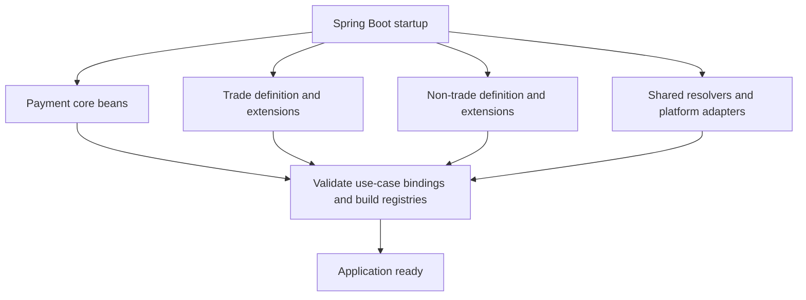
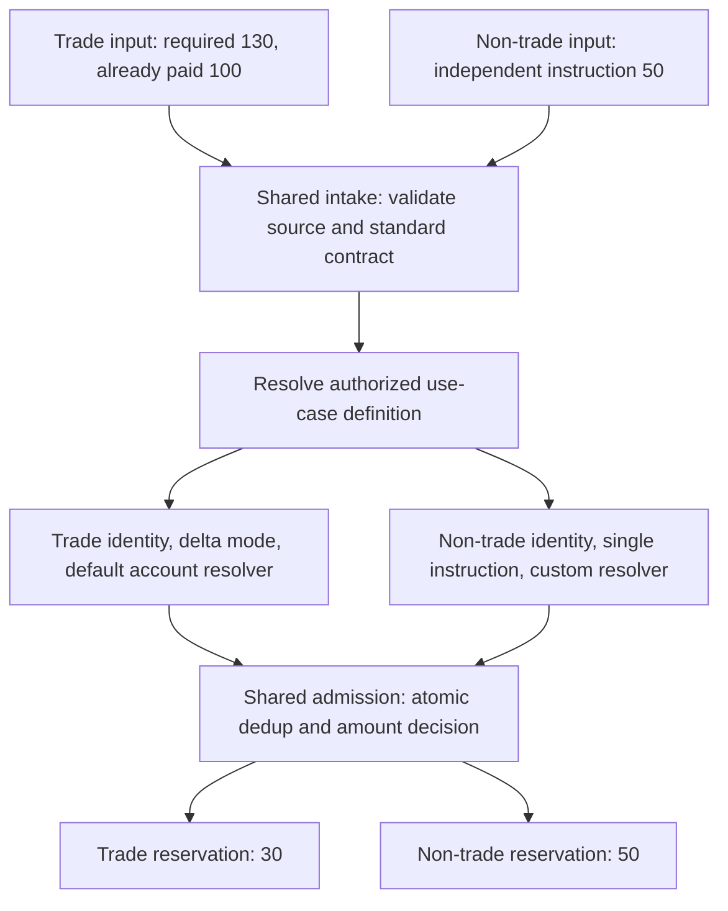
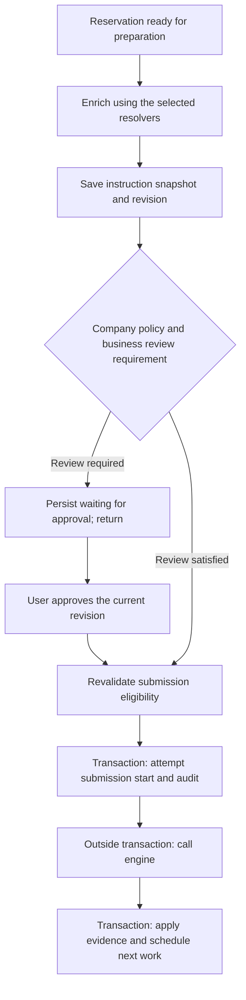
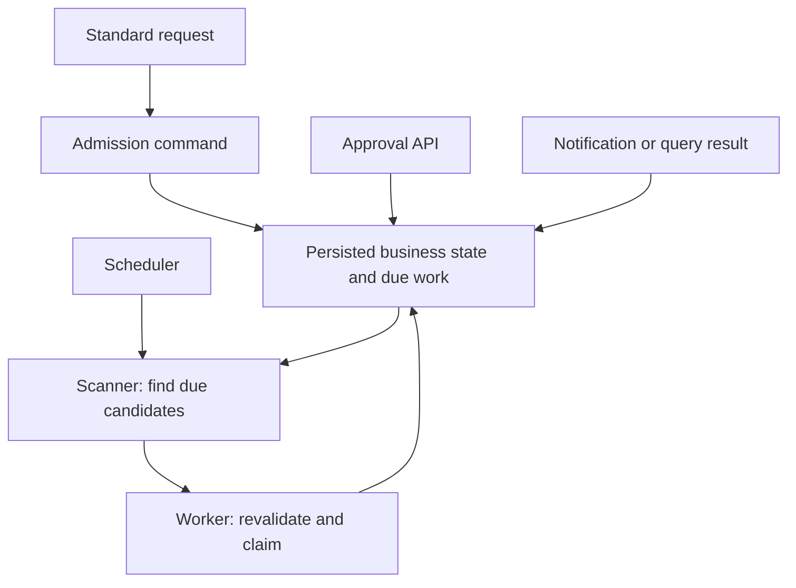

# Modular Payment Platform: State Model, Extension Points, and Execution

**Discussion baseline: 2026-10-09.** This document consolidates the design discussion for a reusable Spring Boot payment service supporting trade and non-trade use cases.

The selected business model is **obligation → reservation → attempt**, with a long-lived reservation spanning retries and asynchronous confirmation. Events primarily provide audit history. Spring Modulith, the package layout, API shapes, and execution mechanisms below are architectural recommendations, not a claim that the repository already implements them. Identifiers, enums, and Java snippets are illustrative.

This is a separate design track from the earlier [event-model proposal](../event-model-design/00-README.md) and [requirements baseline](../requirment-v4.md). It explicitly changes the authority model: payment decisions use persisted business state rather than folding an authoritative event stream. It does not silently amend the older documents, replace their provider contracts, or provide a production schema migration. The earlier [legacy migration and delta approval discussion](../event-model-design/03-legacy-migration-and-delta-approval.md) remains useful business context; its event/witness implementation must be translated before reuse here.

## 1. Goals and boundaries

The service should reuse its payment lifecycle, execution, tracking, and safety mechanisms across business use cases. Adding a use case within supported capabilities should normally require a business definition and a small number of interface implementations, without editing core payment transitions.

Upstream systems own source-format parsing, normalization, and portfolio routing. They submit a standard payment command. The payment service still validates that command, authenticates its source, enforces authorization, and performs atomic admission and deduplication.

Business extensibility does not mean arbitrary payment semantics. The platform owns supported money modes, execution knowledge, reservation release rules, and mandatory approval controls. A genuinely new capability, such as partial execution or refunds, may require deliberate core evolution.

The initial recommendation assumes at most one unresolved reservation per obligation. Waiting for approval, retry, or confirmation still counts as unresolved. This is a simplifying design constraint to confirm against implementation, not a consequence of the table names. If a use case needs concurrent independent reservations, aggregate exposure and scheduling rules must explicitly support it.

## 2. Authoritative business state

| Record | Meaning | Lifetime and responsibility |
|---|---|---|
| `obligation` | A business payment obligation or scope | Admission identity, applicable amount policy, aggregate paid/reserved facts, and permission to create a reservation |
| `reservation` | One concrete payment instruction; the long cycle | Fixed payment amount, stable payment identity, instruction revisions, approval, retry eligibility, execution knowledge, and outcome |
| `attempt` | One execution round within a reservation | Input/snapshot references, start/end information, submission evidence, results, and errors |
| Audit event | Evidence of an action or transition | Who did what, why, when, and against which business and policy versions |

“Three tables” refers to the three core business entities. Audit, inbox, input snapshots, reliable publication records, or approval evidence may require auxiliary storage.

The reservation record remains after its monetary reservation is released or converted to paid value. It is the durable identity of that payment, not an ephemeral lock record.

An attempt can finish while the payment remains unresolved. For example, a timed-out call may end the local execution round while the reservation remains possibly executed and requires reconciliation. An attempt's failure flag never independently authorizes another POST.

### 2.1 Identity and lifecycle

The existing generation concept can identify the long-lived payment represented by a reservation. If generation and reservation have the same boundary, avoid maintaining separate, independently evolving state machines for them.

| Situation | Reservation / generation | Attempt |
|---|---|---|
| First payment instruction | Create | Start an execution round |
| Safe retry of the same instruction | Keep | Create a new execution round according to the attempt contract |
| Waiting for human approval | Keep | No new attempt merely because a scanner polls |
| Engine accepted, confirmation pending | Keep unresolved | Record the submission result |
| Timeout or ambiguous outcome | Keep unresolved | Record uncertainty; reconcile |
| Authoritative successful outcome | Complete | Retain execution history |
| Authoritative terminal rejection of the instruction | Close according to policy | Retain rejection evidence |
| New underpay instruction or authorized successor | Create a new reservation | Start its own execution round |

“Submission complete” must not ambiguously mean both “HTTP call returned” and “payment execution is confirmed.” Only the applicable authoritative outcome or proven safe cancellation permits final release. A retryable rejection and rejection of a duplicate call are not automatically terminal outcomes for the original payment.

Within the same payment instruction, keep the end-to-end ID and the provider idempotency identity stable across attempts. New difference payments are distinct instructions. Whether an end-to-end ID itself provides provider deduplication must be established by the engine contract.

Attempt creation timing needs one explicit contract. An attempt may cover a preparation-and-submission round, or a narrower execution round. Record POST initiation distinctly either way: preparation retries, approval waits, and status queries must not accidentally consume the POST retry budget.

### 2.2 Amount policies

Offer a finite set of platform-owned modes rather than a business-supplied arbitrary money algorithm:

- **Cumulative amount mode:** a message updates the required total; the platform may create a difference payment when the current reservation is resolved and all gates permit it.
- **Independent instruction mode:** each stable instruction identity represents a payment. An amount-changing message with the same identity follows an explicit amendment/conflict policy rather than silently becoming an underpay calculation.

For example, a trade with 100 already paid and a new required total of 130 can create a reservation for 30, assuming no unresolved reservation and no other accounted amounts. A non-trade instruction for 50 creates a reservation for 50 under its own business identity.

“No underpay” alone is incomplete: define whether later increases are rejected, ignored with a recorded disposition, or sent for manual handling. Do not let a Boolean leave that behavior implicit.

Distinguish actual overpayment from potential overpayment involving an unresolved reservation. Before submission, a stale instruction can be blocked or safely canceled under policy. Once execution is possible, retain exposure and resolve it; do not release it just because required has decreased. Overpayment does not imply an automatic negative payment or refund.

## 3. Five categories of behavior

| Category | Business freedom | Platform responsibility | Examples |
|---|---|---|---|
| 1. Fixed core mechanisms | Supply valid commands | Enforce invariants and lifecycle | Transactions, concurrency, attempts, tracking, result deduplication |
| 2. Controlled policies | Select supported options; request stricter controls | Define semantics and valid combinations; enforce company policy | Cumulative versus independent amounts, additional review requirements |
| 3. Default implementations with extension interfaces | Reuse or explicitly substitute a capability | Validate outputs and apply them safely | Account resolution, product-code lookup |
| 4. Business-specific semantic interfaces | Implement genuinely business-dependent meaning | Execute the result atomically and consistently | Business identity, source revision interpretation, business prerequisites |
| 5. Business follow-up actions | Subscribe to relevant committed facts | Provide reliable publication facilities | Update upstream progress, create a task, send a notification |

These categories describe extension permissions and responsibilities; they are not five independent workflow engines.

### 3.1 Deduplication: business meaning versus enforcement

A business extension may identify which fields mean “the same payment obligation” or “a newer revision.” The core owns unique identities, atomic lookup/create, version admission, and races.

Prefer an interface returning a structured `BusinessIdentity` over a standalone `boolean isDuplicate(...)`. Two concurrent callers can both observe “not duplicate” unless creation is protected by a shared atomic mechanism. Include the source/use-case namespace in the identity contract where necessary.

Keep three identities distinct: input-delivery identity, business obligation/instruction identity, and provider execution identity. If the standard input already expresses the complete business identity, no custom resolver is necessary.

### 3.2 Approval and enrichment

Business configuration may add a review requirement. It cannot disable company-mandated approval, define its own approval limits, or bypass maker-checker separation.

Approval binds to the reservation and the actual instruction revision, including material amount/account/currency information. A long reservation does not make an old approval permanently valid. Enrichment results are saved as versioned snapshots; late worker results must not overwrite newer input. Material changes invalidate or require revalidation of approval under an explicit rule.

Resolvers return data or defined failure classifications. They do not mutate payment entities, allocate attempts, release money, or directly submit to the engine. Where only a mapping table differs, prefer configuration over another custom Java implementation.

### 3.3 Follow-up actions

Publish stable facts such as `PaymentConfirmed`, `PaymentRejected`, and `PaymentRequiresAttention`. A trade subscriber might update trade progress; a non-trade subscriber might notify its owning system.

Failure to deliver a notification must not convert a successful payment into a failed payment or resubmit it. A mandatory pre-payment check belongs in the controlled payment path, not a best-effort listener.

Audit events and integration events can share infrastructure but have different contracts. Internal audit detail should not automatically become a public integration schema.

## 4. Spring Boot and Spring Modulith structure

Use one Spring Boot application with logical modules. Spring Modulith adds structure verification, module testing, and optional event facilities; it is not a workflow orchestrator or a separate dependency-injection container.

| Package under `com.example.payments` | Responsibility |
|---|---|
| `payment` | Public payment command API |
| `payment.spi` | Business definitions, extension interfaces, immutable input/result types |
| `payment.events` | Published business event contracts |
| `payment.internal` | Entities, repositories, state transitions, orchestration, registry, and workers |
| `enrichment` | Public access to reusable resolvers, with implementations hidden internally |
| `authorization` | Company authorization and approval-policy integration |
| `engine` | Engine adapter implementing a core-owned gateway contract |
| `trade` | Trade definition, required business semantics, and follow-up subscribers |
| `nontrade` | Non-trade definition, semantics, optional custom resolvers, and subscribers |

The three business entities remain within the payment consistency boundary. Do not split them into autonomous services merely because they are separate tables.

The dependency direction matters: extensions and infrastructure adapters implement core-owned contracts. The core must not import their concrete implementations. Company policy can similarly be exposed through a core-owned port to avoid a module cycle. Spring configuration wires implementations at startup.



All these beans normally live in one `ApplicationContext`. There is no independent “start trade module, then start payment module” protocol. Bean initialization follows dependencies.

### 4.1 API, SPI, and registration

An API exposes commands that callers execute. An SPI exposes a capability that an extension implements.

```java
public interface AccountResolver {
    String id();
    AccountResolution resolve(AccountResolutionRequest request);
}

public interface BusinessIdentityResolver {
    String id();
    BusinessIdentity identify(StandardPaymentCommand command);
}

public record UseCaseDefinition(
    String id,
    MoneyMode moneyMode,
    ReviewRequirement reviewRequirement,
    String identityResolverId,
    String accountResolverId
) {}
```

Register definitions through ordinary `@Configuration` / `@Bean` methods. Build registries from the definitions and resolver beans, rejecting duplicate IDs, missing implementations, and unsupported combinations at startup. Additional capabilities can be added explicitly; avoid a generic mutable context bag or an ever-growing inheritance hierarchy.

| Binding | Trade example | Non-trade example |
|---|---|---|
| Money mode | `CUMULATIVE_DELTA` | `SINGLE_INSTRUCTION` |
| Review requirement | `REQUIRE_REVIEW` | `COMPANY_POLICY` |
| Identity resolver | `trade-identity` | `nontrade-identity` |
| Account resolver | `standard-account` | `nontrade-account` |

`COMPANY_POLICY` does not mean approval is disabled. The non-trade example below assumes that policy permits automatic processing for this particular instruction.

Multiple resolvers coexist. Do not use one global `@Primary`, a deployment-level Spring `@Profile`, or type-wide `@ConditionalOnMissingBean` as per-use-case dispatch. `@ConditionalOnMissingBean` is useful for library defaults, but one custom resolver must not unintentionally remove the default used by another business.

Record the relevant business-definition and policy versions in decision/audit evidence. A configuration deployment must not silently change a live reservation's monetary semantics; define controlled adoption for changed business configuration and explicit handling of updated mandatory company policy.

### 4.2 Module boundary verification

Export SPI and event packages explicitly:

```java
// payment/spi/package-info.java
@org.springframework.modulith.NamedInterface("spi")
package com.example.payments.payment.spi;
```

Use an analogous named interface for `payment.events`. A business module that only implements SPI and consumes events can declare:

```java
// trade/package-info.java
@org.springframework.modulith.ApplicationModule(
    allowedDependencies = {"payment :: spi", "payment :: events"}
)
package com.example.payments.trade;
```

Declare additional public dependencies only when needed. Verify the structure explicitly:

```java
@Test
void moduleBoundariesAreValid() {
    ApplicationModules.of(PaymentApplication.class).verify();
}
```

This is an architecture test, not runtime bean isolation. Add targeted ArchUnit rules to prevent business extensions from accessing payment repositories or engine clients directly. These controls govern trusted application code; they are not a sandbox for untrusted plugins.

## 5. What composes the payment flow?

Core application services own orchestration. Spring DI supplies collaborators; registries select business implementations; domain rules decide legal transitions. Spring Modulith does not automatically assemble or execute the workflow.

| Application service | One bounded responsibility |
|---|---|
| Admission | Validate and deduplicate intake, update obligation, create eligible reservation or record another disposition |
| Preparation | Claim work, enrich, save a validated snapshot, and decide review readiness |
| Approval | Check actor/policy/revision and record approval |
| Submission | Prepare an attempt, call the engine, and persist the result |
| Outcome handling | Apply synchronous, query, and notification evidence consistently |

Use composition rather than subclassing a large `AbstractPaymentService`. The core chooses when to invoke extensions; extensions cannot reorder or skip mandatory gates.

Separate sequencing from decisions. Platform-owned amount rules, approval rules, submission eligibility, and outcome application can be ordinary Java components. They should return explicit decisions; one command boundary applies the resulting mutations. Avoid distributing writes among policy evaluators.

### 5.1 Trade and non-trade intake



The branches select implementations, not separate payment engines inside the application. Repeated input returns or records the existing disposition rather than opening another reservation. The example assumes no unresolved reservation or additional legacy-accounted amount.

### 5.2 Execution and waiting



Enrichment failures branch into retry or manual handling; they do not proceed to submission. Approval applies to the saved revision. If the attempt already covers preparation, submission updates that attempt instead of allocating a second one just for the POST.

“One bounded advancement” means a call completes the work it can currently do and returns when it must wait. It does not require a queue boundary after every small step. Adjacent automatic steps can run immediately, while preserving separate transaction boundaries around external I/O.

## 6. Durable continuation: orchestrator, scanner, and direct triggers

The orchestrator advances ready work. At a waiting point, it commits enough state to describe the next action and returns. A later trigger invokes the appropriate command from that point rather than blindly restarting the lifecycle.

| Component | Responsibility |
|---|---|
| Database | Persist current facts, input/snapshot references, scheduled work, and claim information |
| Scheduler | Periodically wake a scanner |
| Scanner | Select bounded batches of due candidates |
| Worker / command service | Revalidate, claim, execute, and save the outcome |
| Approval API / notification consumer | Trigger state advancement directly from user actions or external evidence |

These are persisted work descriptions, not database triggers. A scheduled scanner may be implemented using Spring scheduling or existing scheduling infrastructure; the schedule itself is not the durable source of work.



For example, an enrichment failure stores `ENRICH` due at 11:10. If the application restarts and recovers at 11:12, the scanner can still find that work. No original thread or in-memory timer must survive.

Not all waits require polling: approval comes through an API, confirmation through a consumer, and delayed retry/query through scanners. Immediate wake-up after a commit can reduce latency; persisted eligibility remains the recovery mechanism if the wake-up is lost.

### 6.1 Candidate selection and claims

Select candidates from indexed current reservation/work state, not by scanning audit history. A conceptual predicate is `action = requestedAction AND due_at <= now`, ordered and limited to a batch.

Do not assume one exclusive `next_action` field covers every rule. Existing unknown-payment behavior may require ongoing queries even when a guarded same-key retry becomes eligible. Separate submission/preparation scheduling from query scheduling if both can be active. The same reservation row can hold both clocks; this does not automatically require another table.

Workers must recheck current state and atomically claim work under the agreed lock/CAS protocol. Long cycle ID equality alone cannot distinguish two workers attempting the same action; use an action/attempt token and current version as appropriate. Fence stale preparation results. Authoritative late provider evidence must still be reconciled rather than discarded solely because a worker token expired.

For this design, a straightforward implementation serializes money-affecting commands on the obligation row and uses a consistent lock order when reservation/attempt rows are also locked. Reuse an equivalent established protocol if one already exists; do not introduce an independent lock scheme for each business extension.

### 6.2 External calls and crash recovery

Submission uses three explicit phases:

1. In a short transaction, validate the current reservation, approval, amount, freeze, and budget; persist the submission-start evidence and immutable instruction association.
2. Outside the transaction, call the engine with the stable payment identity.
3. In a short transaction, associate and apply the result, updating business state and audit together.

A committed submission start followed by a crash or missing result means possible execution. Lease expiry does not prove the request was never sent. Recover through query/reconciliation and the provider's documented same-key retry rules, not unconditional resubmission.

An attempt may be created without a POST. Charge the POST budget at the durable submission-start boundary, conservatively counting a committed start even if a crash prevents proof that bytes reached the wire. Distinguish that safety accounting from telemetry reporting observed network calls. Enrichment polls, queries, and failures before a committed submission start do not consume the POST budget.

Manual retry uses the same core execution rules as auto retry, with additional authorization and recorded rationale. Budget extensions are explicit decisions rather than erasure of earlier attempts. Fleet posting freeze prevents new posting claims; query/evidence processing can continue. A freeze cannot retroactively prove that an already-claimed request was not sent. Use bounded batches and rate limits for recovery, with recorded jittered due times and versioned retry policy.

Avoid layered hidden POST retries in the HTTP client, retry annotations, and scanner. Each actual attempt must correspond to the application's explicit execution accounting.

## 7. Intake through HTTP or messaging

An HTTP API is a suitable intake adapter: synchronously accept the input durably, then process asynchronously. A Kafka consumer can call the same admission service; transport should not fork payment semantics.

Recommended intake behavior:

1. Authenticate the caller and verify permission to use the declared use case.
2. Validate the standard command and input identity/version.
3. Atomically persist the intake snapshot, deduplication result, and initial work/admission state.
4. Return success only after commit. If admission is deferred, persist a durable pending admission item before returning.

```http
POST /payment-intakes
Idempotency-Key: source-request-123
Content-Type: application/json

{
  "useCaseId": "trade",
  "sourceEventId": "event-123",
  "businessReference": "trade-456",
  "businessVersion": 7,
  "amount": "130.00",
  "currency": "USD"
}
```

This abbreviated example omits additional standard payment fields. The use-case definition determines the amount semantics; unsupported or contradictory declarations are rejected.

```http
HTTP/1.1 202 Accepted
Location: /payment-intakes/intake-789
Content-Type: application/json

{"intakeId":"intake-789","status":"ACCEPTED"}
```

`ACCEPTED` means the intake is durably owned for processing. It does not mean a reservation necessarily exists, the engine accepted a payment, or money was paid. Provide intake status independently from reservation/payment status. Invalid commands receive an appropriate immediate error; deferred business rejection appears in the durable processing result.

Scope idempotency keys by authenticated source. A retry with the same key and equivalent canonical content returns the same intake identity and its current disposition. Reusing the key with different content is a conflict. Map the HTTP key and source event identity consistently so changing only the HTTP key cannot bypass message deduplication. New business revisions have their own delivery identity and explicit ordering/version rules.

Store sufficient input locally for later execution and audit. Prefer the complete payment-relevant standard input over an ID requiring an unversioned upstream lookup. If size or ownership requires retrieval, use an immutable/versioned reference and persist the resolved input before payment decisions.

Do not return success after merely launching `@Async` work. For Kafka, acknowledge only after durable acceptance according to the consumer transaction/offset design; redelivery must be harmless. Upstream producers remain responsible for reliable delivery or retry until intake has been accepted.

Existing inbox/snapshot storage may implement intake persistence. These endpoint names do not mandate a new table.

## 8. Framework choices and operational boundaries

| Mechanism | Recommended use |
|---|---|
| Spring Boot + constructor injection | Application startup, component composition, validated configuration |
| Spring Modulith | Module boundaries, verification, module integration tests, optional reliable event publication |
| ArchUnit | Additional restrictions on repository/client access and dependency direction |
| Ordinary Java policies and transitions | Explicit, testable payment decisions without a generic workflow DSL |
| Spring transactions | Short atomic command boundaries; use separate proxied beans or `TransactionTemplate` |
| Spring Security | Entry-point and method authorization, integrated with company policy |
| Persistent publication registry or outbox | Reliable business follow-up delivery; consumers remain idempotent |

An ordinary `@TransactionalEventListener(AFTER_COMMIT)` alone is not a durable queue. If using Modulith's publication registry, configure persistent storage and an appropriate multi-instance recovery policy; do not assume startup replay or external side effects are automatically exactly-once.

Audit writes for business transitions belong in the same transaction as the corresponding state changes. Remote log export is separate. Events are not replayed to authorize payments in this model.

Use explicit transaction boundaries around external I/O. Same-class calls do not activate proxy-based `@Transactional` advice. Failed result persistence after an engine call leaves unresolved submission evidence, not proof of failure.

Spring Statemachine, a rules engine, or a BPM/workflow engine can be reconsidered when concrete requirements justify them. They are not prerequisites for a finite set of money modes, maker-checker, and durable retries. Extract a Boot starter when multiple applications genuinely need the shared package; additional use cases in one application do not by themselves require one.

## 9. Validation and onboarding

New use-case onboarding should normally consist of:

1. Agree the upstream standard-message and business identity/version contract.
2. Select supported money and review modes.
3. Bind shared resolvers and implement only required differences.
4. Register optional follow-up subscribers.
5. Run module checks, extension contract tests, and relevant payment scenarios.

Useful validation focuses on behavior, not the number of abstractions:

- Trade delta and non-trade independent instructions select different policies through the same core commands.
- Concurrent duplicate intake produces one accepted business effect; conflicting same-key content is rejected.
- New input or enrichment revisions cannot inherit stale approval; maker-checker cannot be bypassed by a business option.
- Duplicate workers cannot independently submit the same scheduled action.
- A crash after submission-start persistence or engine execution recovers as unresolved rather than a fresh payment.
- Confirmation arriving before the synchronous response does not regress a completed reservation; contradictory evidence follows the exception path.
- Restart preserves due work and notification-delivery failures do not retry payment.
- A custom resolver affects only explicitly bound use cases.

Use the actual database family for meaningful concurrency and transaction integration tests. API mocks should exercise timeout and late-response cases, not only success/rejection. This document adds no implementation or test suite.

Before implementation, confirm the exact attempt boundary, supported money-mode semantics, provider outcome/identity guarantees, policy-version adoption rules, and the single-unresolved-reservation constraint. These are business and execution contracts; module annotations cannot decide them.

## 10. Reference material

Official and original references consulted for this discussion:

- [Ports and Adapters — original Hexagonal Architecture article](https://alistair.cockburn.us/hexagonal-architecture/): core-owned ports and replaceable adapters.
- [Spring Modulith fundamentals](https://docs.spring.io/spring-modulith/reference/fundamentals.html): modules, named interfaces, and dependency declarations.
- [Spring Modulith verification](https://docs.spring.io/spring-modulith/reference/verification.html): executable checks of module boundaries.
- [Spring Modulith events](https://docs.spring.io/spring-modulith/reference/events.html): publication registry and event delivery.
- [Spring Modulith examples](https://github.com/spring-projects/spring-modulith/tree/main/spring-modulith-examples): implementation examples, not payment-safety guarantees.
- [Spring Boot auto-configuration](https://docs.spring.io/spring-boot/reference/features/developing-auto-configuration.html): shared defaults and starter design.
- [Spring transaction annotations](https://docs.spring.io/spring-framework/reference/data-access/transaction/declarative/annotations.html) and [programmatic transactions](https://docs.spring.io/spring-framework/reference/data-access/transaction/programmatic.html): transaction boundaries and proxy behavior.
- [Spring Security method security](https://docs.spring.io/spring-security/reference/servlet/authorization/method-security.html): authorization integration.
- [ArchUnit user guide](https://www.archunit.org/userguide/html/000_Index.html): dependency and architecture tests.
- [Asynchronous request-reply pattern](https://learn.microsoft.com/en-us/azure/architecture/patterns/asynchronous-request-reply): durable acceptance and status-resource API design.

Select dependency versions compatible with the application's existing Spring Boot line. Examples here intentionally do not prescribe a release version.
